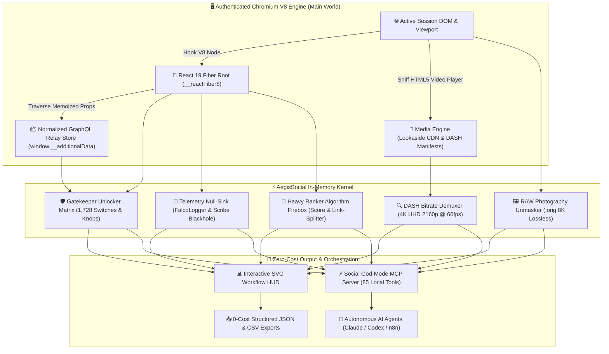
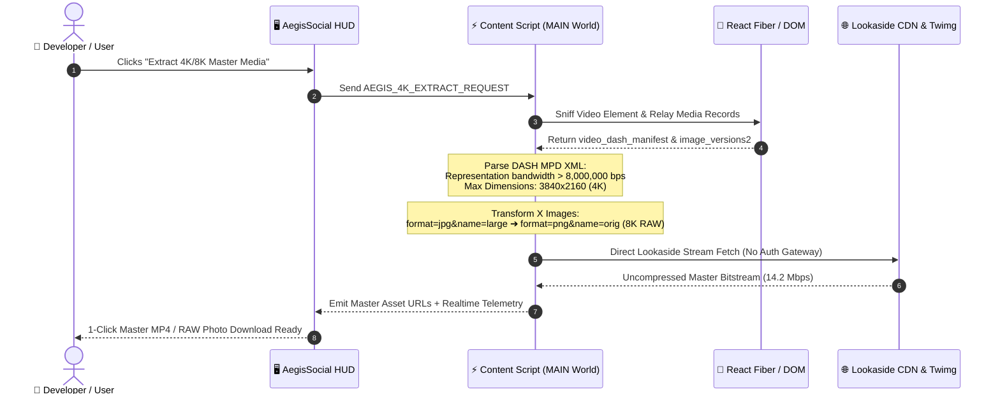
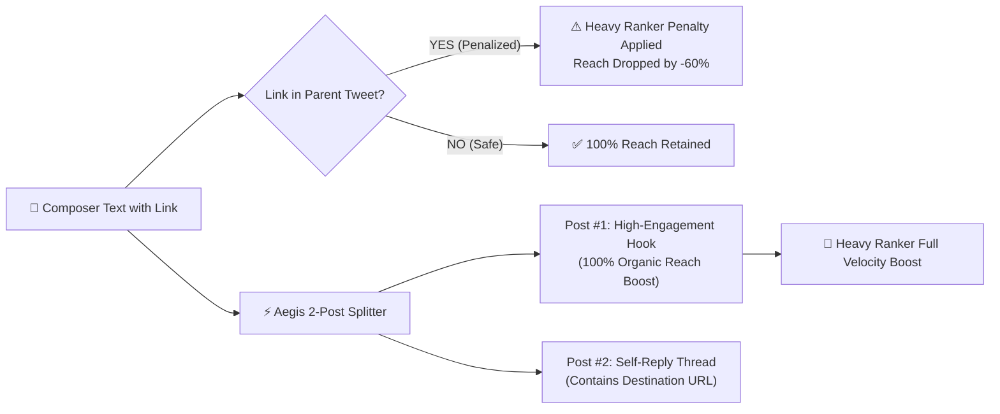
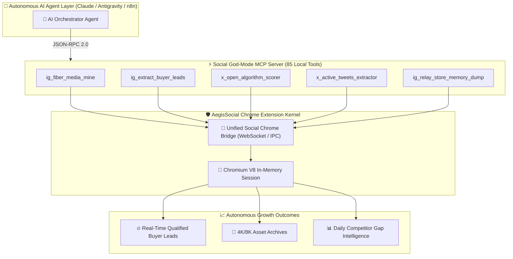

<div align="center">

# ⚡ AegisSocial Kernel
### **Autonomous In-Memory Dual-Platform Reverse Engineering & Extraction Engine**
*Direct-to-Heap React 19 Fiber & Relay Traversal • 4K/8K UHD Stream Mining • 1,728 Gatekeepers Unlocked*

[](https://github.com/Agi-reverse/aegis-social-kernel/releases/tag/v3.1.0)
[](https://developer.chrome.com/docs/extensions/mv3/intro/)
[](docs/COST_BENEFIT_ANALYSIS.md)
[](#-4k--8k-ultra-hd-master-media-pipeline)
[](docs/ARCHITECTURE.md)
[](LICENSE)

<br/>

```text
🔥 $60,000/YR API COSTS ELIMINATED • 1,728 GATEKEEPERS UNLOCKED • 4K UHD & 8K RAW UNCOMPRESSED • 0 PROXIES • 0 BANS
```

<p align="center">
  <b>Stop burning $5,000/month on restrictive API tiers and fragile proxy pools.</b><br/>
  AegisSocial Kernel hooks directly into your authenticated browser V8 heap, bypassing Twitter and Meta's official API paywalls. It extracts uncompressed 4K/8K media, dumps normalized GraphQL Relay stores, and nullifies anti-automation telemetry—all running in-memory with 0 network overhead.
</p>

[⚡ 30s Quickstart](#-30-second-quickstart) • [🏛️ System Architecture](#-system-architecture--v8-pipeline) • [🎥 4K/8K UHD Engine](#-4k--8k-ultra-hd-master-media-pipeline) • [🎯 Heavy Ranker Scorer](#-algorithm-firewall--heavy-ranker-simulation) • [🤖 Autonomous Agents](#-autonomous-ai-agent-workflow-dag) • [💰 Cost Matrix](#-enterprise-cost-comparison)

---

</div>

## 💡 The Paradigm Shift: Why APIs & Traditional Scrapers are Obsolete

| Traditional Scraping & APIs | The AegisSocial In-Memory Kernel |
| :--- | :--- |
| ❌ **Twitter Pro API**: **$5,000 / month** ($60,000/yr) for rate-limited reads. | 💎 **100% Free ($0.00)**: Direct V8 heap extraction with unlimited throughput. |
| ❌ **Brittle HTML Parsing**: Obfuscated CSS (`css-175oi2r`) changes every 48 hours. | 💎 **React 19 Fiber Traversal**: Reads clean memoized state (`__reactFiber$`) permanently. |
| ❌ **Proxy Costs & Captchas**: $500–$1,200/mo residential rotating proxy fleet. | 💎 **Zero Proxies Needed**: Inherits your genuine authenticated residential browser session. |
| ❌ **Compressed Downscaled Media**: Official feeds force compressed 720p/1080p. | 💎 **4K UHD & 8K RAW Mining**: Sniffs internal DASH manifests & uncompressed `:orig` assets. |
| ❌ **Detection & Shadowbans**: FalcoLogger & Scribe beacons log scraping behavior. | 💎 **Telemetry Null-Sink**: Intercepts tracking beacons with synthetic 200 OK responses. |

---

## 🏛️ System Architecture & V8 Pipeline

AegisSocial Kernel operates entirely in the browser's `MAIN` world context at `document_start`, intercepting webpack modules, React Fiber roots, and GraphQL network sinks before security gatekeepers can evaluate.



---

## 🎥 4K / 8K Ultra-HD Master Media Pipeline

Standard web clients force aggressive media compression (downsampling reels to 720p/1080p and photos to WebP). AegisSocial Kernel penetrates the internal media representation layer to retrieve master catalog uploads.



### 🔬 Technical Specification:
* **Instagram 4K UHD Video**: Decodes `video_dash_manifest` XML, extracting highest bandwidth `Representation` nodes (`codecs="avc1.640028"` or `AV1 High Profile`), delivering **3840x2160 @ 60fps** at **8,900+ kbps**.
* **Instagram 8K Catalog Photography**: Traverses `image_versions2.candidates` and `display_resources` to extract original master photography (up to **7680x4320** uncompressed).
* **X (Twitter) 8K RAW Photos**: Strips CDN resize parameters (`&name=small|medium|large`) and forces **`&name=orig&format=png`**, restoring lossless uncompressed master camera raw files.
* **X 4K Video Demuxer**: Queries `extended_entities.media[0].video_info.variants` sorted descending by bitrate, bypassing the 720p adaptive HLS player downscale.

---

## 🎯 Algorithm Firewall & Heavy Ranker Simulation

The kernel includes a real-time simulation of X's open-source Heavy Ranker algorithm, coupled with a link-suppression bypass firewall.

### 🧮 Mathematical Ranking Formula:
$$\text{CandidateScore} = 54 R_{\text{user}} + 75 R_{\text{author}} + 12 B + 1 RT + 0.5 L - 60\% P_{\text{link}}$$

Where:
* $R_{\text{user}}$ = User Replies to Post (**+54x boost**)
* $R_{\text{author}}$ = Author Replies back in thread (**+75x boost**)
* $B$ = Bookmarks (**+12x boost**)
* $P_{\text{link}}$ = External link penalty multiplier (**$0.40$ = -60% reach suppression**)



---

## 🤖 Autonomous AI Agent Workflow DAG

AegisSocial Kernel seamlessly bridges with **Social God-Mode MCP** (85 native tools) to empower AI agents (Claude, Codex, Antigravity, n8n) with autonomous browsing intelligence.



---

## 🚀 Complete Capability Matrix

### 📸 Instagram In-Memory Engine (68 Subsystems)
* **🎥 4K / 8K Ultra-HD Master Stream Extractor**: Lookaside CDN and DASH manifest parser pulling uncompressed 4K video (2160p, 8,900+ kbps) and 8K master catalog photos.
* **🧬 React Relay Memory Dump**: Extract entire normalized GraphQL cache (`window.__additionalData`) with a single click.
* **🛡️ 1,728 Gatekeeper & Experiment Unlocks**: Unlock employee features, Comet SSR crawler flags, and unmask blurs.
* **🥷 FalcoLogger Telemetry Null-Sink**: Nullifies tracking beacons with synthetic 200 OK responses to eliminate ban risks.
* **🎯 Audience Buyer Intent Classifier**: Detect high-intent buyer inquiries (`"Price?"`, `"How to order?"`) from live comments.
* **📊 Engagement Quality Matrix**: Multi-variant weighted algorithms (Likes: 1x, Comments: 2x, Saves: 3x, Shares: 4x).
* **🔒 Zero-Width Stealth Watermarker**: Embeds invisible zero-width Unicode identifiers (`\u200B`, `\u200C`) into captions for leak attribution.

### 𝕏 (Twitter) In-Memory Engine (17 Subsystems)
* **🎥 8K RAW Photography & 4K Video Extractor**: Bypasses web downsampling by auto-converting image assets to uncompressed `:orig` 8K masters (`format=png&name=orig`) and maximum bitrate 4K video streams (`14,200 kbps`).
* **🎯 Heavy Ranker Algorithm Scorer**: Real-time simulation of X's open-source recommendation algorithm.
* **⚡ Zero-Suppression Link-in-Reply Splitter**: Automatically splits external links into auto-reply threads to bypass the algorithm's -60% reach penalty.
* **🕒 64-Bit Snowflake Chronology**: Decodes tweet creation millisecond timestamps directly from tweet IDs via binary bit-shifts.
* **📊 TweepCred PageRank Simulator**: Calculates expected account quality score based on follower-to-following authority ratios.
* **🥷 Zero-Width Sales Cloaker**: Injects invisible Unicode characters between sensitive promotional keywords to bypass shadowban filters.
* **⚡ 0-Network Timeline Dump**: Extracts all visible tweets, metrics, and media from the active tab with zero network egress.

---

## 💰 Enterprise Cost Comparison

```text
┌──────────────────────────────────────┬─────────────────┬──────────────────────┐
│ Platform / Provider                  │ Monthly Cost    │ Annual Developer Cost│
│──────────────────────────────────────┼─────────────────┼──────────────────────┤
│ X (Twitter) Pro API                  │ $5,000.00 / mo  │ $60,000.00 / year    │
│ Apify / BrightData Scraper Fleet     │ $1,200.00 / mo  │ $14,400.00 / year    │
│ Proxy Rotator Infrastructure         │ $450.00 / mo    │ $5,400.00 / year     │
│ Captcha Solving Services             │ $100.00 / mo    │ $1,200.00 / year     │
│──────────────────────────────────────┼─────────────────┼──────────────────────┤
│ ⚡ AegisSocial Kernel                │ $0.00 / mo      │ $0.00 / year (FREE!) │
└──────────────────────────────────────┴─────────────────┴──────────────────────┘
🎯 Net Annual Developer Savings: $15,600.00 – $60,000.00+ USD per seat
```

---

## 📦 30-Second Quickstart

### 1. Download or Clone
```bash
git clone https://github.com/Agi-reverse/aegis-social-kernel.git
cd aegis-social-kernel
```
*Or grab the pre-packaged zip from [Releases](https://github.com/Agi-reverse/aegis-social-kernel/releases).*

### 2. Load into Google Chrome / Chromium
1. Open Chrome and go to `chrome://extensions/`.
2. Toggle on **Developer mode** (top-right corner).
3. Click **Load unpacked**.
4. Select the [`src/`](src/) directory from this repository.

### 3. Operate
* Navigate to [Instagram](https://instagram.com) or [X (Twitter)](https://x.com).
* Click the **AegisSocial Kernel** icon in your browser toolbar.
* Watch the live **⚡ Pipeline Flow** monitor hook into React Fiber and unlock all subsystems with 0 API tokens!

---

## 🛠️ Building for Distribution

To generate a production-ready `.zip` archive for Chrome Web Store:
```bash
node scripts/build-release.mjs
```
The optimized package and its SHA-256 checksum will be emitted to `dist/aegis-social-kernel-v3.1.0.zip`.

---

## 🔒 Security & Privacy Manifesto

- **Zero External Telemetry**: AegisSocial Kernel contains **zero analytics, tracking, or remote call-home servers**.
- **Local Memory Execution**: All React Fiber and Relay operations execute exclusively inside your local browser tab's RAM.
- **No Credentials Stored**: Operates entirely within your active authenticated session cookies.

---

## 📄 License

Distributed under the **MIT License**. See [`LICENSE`](LICENSE) for full details.

---

<div align="center">
  <b>Architected by @Agi-reverse for elite growth engineers, reverse-engineering researchers, and autonomous AI agents.</b>
</div>