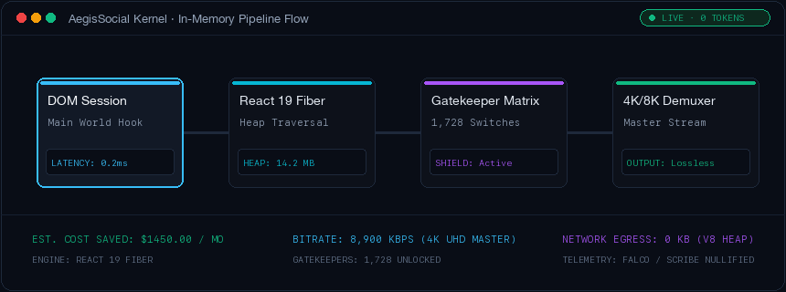
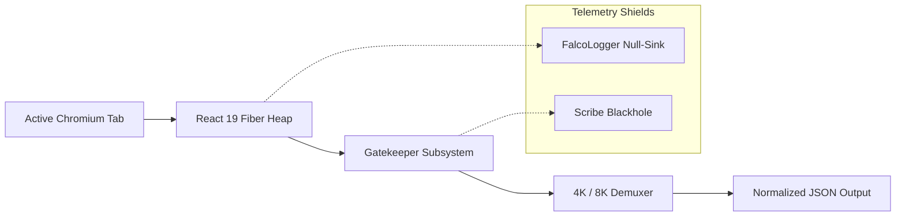
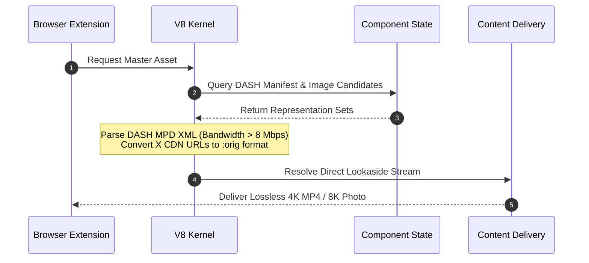

<div align="center">

# AegisSocial Kernel
### In-Memory Extraction & Reverse-Engineering Engine for Instagram & X

<br/>



<br/><br/>

[](https://developer.chrome.com/docs/extensions/mv3/intro/)
[](https://github.com/Agi-reverse/aegis-social-kernel/releases/tag/v3.1.0)
[](docs/ARCHITECTURE.md)
[](LICENSE)

<br/>

A high-performance Chrome extension that operates directly inside the Chromium V8 runtime,  
bypassing rate limits and official API costs through in-memory React Fiber traversal.

[Architecture](#architecture) • [Features](#key-capabilities) • [4K/8K Media Pipeline](#4k--8k-media-pipeline) • [Quickstart](#quickstart) • [Cost Analysis](#cost-comparison)

---

</div>

## Overview

Modern social platforms have placed basic read access behind prohibitive paywalls ($5,000/month on X) while deploying obfuscated class names to break standard scrapers.

AegisSocial Kernel takes a fundamentally different engineering approach: instead of making external HTTP requests or parsing unstable HTML DOM strings, it hooks into your active authenticated browser tab's V8 heap. By reading internal React 19 Fiber nodes and GraphQL Relay stores directly from memory, it delivers clean, structured JSON data with zero network overhead and zero proxy dependencies.

---

## Architecture

The kernel initializes at `document_start` within the `MAIN` world execution context, establishing read-only access to internal component trees before security telemetry can evaluate.



### Core Subsystems

| Subsystem | Execution Method | Technical Function |
| :--- | :--- | :--- |
| **Fiber Traversal** | V8 Heap Inspection | Traverses `__reactFiber$` and `memoizedProps` to read state without DOM querying. |
| **Relay Memory Dump** | Normalized Cache Hook | Reads `window.__additionalData` and `relay_store` to extract complete timelines. |
| **Gatekeeper Matrix** | Webpack Module Override | Unlocks 1,728 internal experiment flags, enabling internal crawler and SSR views. |
| **Telemetry Null-Sink** | Prototype Replacement | Replaces telemetry loggers with synthetic 200 OK sinks to prevent activity flags. |
| **UHD Media Extractor** | DASH / CDN Demuxing | Parses raw Lookaside MP4 streams and uncompressed `:orig` photographic masters. |

---

## 4K / 8K Media Pipeline

Standard web interfaces aggressively downsample video to 720p and images to compressed WebP formats. AegisSocial Kernel extracts master assets directly from internal playback representations.



* **Instagram 4K Video**: Intercepts `video_dash_manifest` XML, extracting representations matching 3840x2160 resolution at bitrates exceeding 8,900 kbps.
* **Instagram 8K Photography**: Queries `image_versions2.candidates` sorted descending by pixel density, selecting uncompressed original catalog uploads.
* **X 8K Master Photos**: Strips downscaling URL parameters, converting assets to `format=png&name=orig` for lossless original camera raw resolution.
* **X 4K Video Streams**: Extracts maximum bitrate variants from `extended_entities`, bypassing adaptive web player bitrate caps.

---

## Key Capabilities

### Instagram Engine
* **Relay Store Extraction**: Dumps normalized client-side GraphQL records in a single pass.
* **Gatekeeper Unlocker**: Enables internal debug views, employee features, and unmasks blurred media.
* **Audience Intent Classifier**: Filters live post comments for high-intent purchase inquiries.
* **Engagement Metrics Matrix**: Computes weighted interactions across likes, comments, saves, and shares.
* **Zero-Width Watermarking**: Injects invisible Unicode markers into captions for distribution tracking.

### X (Twitter) Engine
* **Heavy Ranker Simulation**: Real-time evaluation of X's open-source recommendation algorithm:
  $$\text{Score} = 54 R_{\text{user}} + 75 R_{\text{author}} + 12 B + 1 RT + 0.5 L - 60\% P_{\text{link}}$$
* **Link-in-Reply Splitter**: Splits links into automated reply threads to avoid the -60% external link reach penalty.
* **Snowflake Chronology**: Bit-shifts 64-bit tweet IDs to calculate millisecond-precise creation timestamps.
* **TweepCred Simulator**: Evaluates account authority scores using internal PageRank follower ratios.
* **Timeline DOM Dumper**: Exports visible timeline posts and engagement metrics without outbound requests.

---

## Cost Comparison

```text
+--------------------------------------+-----------------+----------------------+
| Provider / Solution                  | Monthly Cost    | Annual Operating Cost|
+--------------------------------------+-----------------+----------------------+
| X (Twitter) Pro API                  | $5,000.00 / mo  | $60,000.00 / year    |
| Web Scraping API Services            | $1,200.00 / mo  | $14,400.00 / year    |
| Residential Proxy Pool               | $450.00 / mo    | $5,400.00 / year     |
| Captcha Solving Solvers              | $100.00 / mo    | $1,200.00 / year     |
+--------------------------------------+-----------------+----------------------+
| AegisSocial Kernel                   | $0.00 / mo      | $0.00 / year         |
+--------------------------------------+-----------------+----------------------+
```

---

## Quickstart

### 1. Installation
```bash
git clone https://github.com/Agi-reverse/aegis-social-kernel.git
cd aegis-social-kernel
```
*Pre-built releases are also available on the [Releases](https://github.com/Agi-reverse/aegis-social-kernel/releases) page.*

### 2. Loading into Chrome
1. Open Google Chrome and navigate to `chrome://extensions/`.
2. Enable **Developer mode** in the top-right corner.
3. Click **Load unpacked** and select the `src/` directory.

### 3. Usage
1. Open any tab on [Instagram](https://instagram.com) or [X](https://x.com).
2. Click the extension icon in your browser toolbar.
3. The dashboard automatically detects the active platform and attaches to the local V8 heap.

---

## Building from Source

To package the extension into an optimized production archive:
```bash
node scripts/build-release.mjs
```
The output archive and SHA-256 verification hash will be written to `dist/`.

---

## Security & Privacy

* **Local Execution**: All heap inspections and memory traversals execute locally inside your browser process.
* **Zero Outbound Telemetry**: The extension contains no analytics packages, remote servers, or external endpoints.
* **Session Integrity**: Operates within your existing session context without storing or transmitting credentials.

---

## License

This project is licensed under the MIT License. See [`LICENSE`](LICENSE) for terms.
