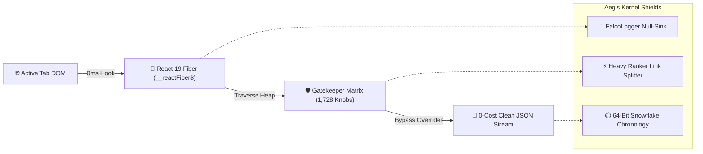

<div align="center">

# ⚡ AegisSocial Kernel
### **Zero-API Cost Dual-Platform Reverse Engineering & Extraction Engine**
*Direct-to-Heap React 19 Fiber & Relay Traversal for Instagram & X (Twitter)*

[](https://developer.chrome.com/docs/extensions/mv3/intro/)
[](docs/COST_BENEFIT_ANALYSIS.md)
[](docs/ARCHITECTURE.md)
[](LICENSE)
[](.github/workflows/ci.yml)

<p align="center">
  <b>Stop burning $5,000/month on restrictive API tiers and rotating proxy services.</b><br/>
  AegisSocial Kernel hooks directly into your authenticated browser heap, unlocking 1,728 Gatekeepers, nullifying tracking beacons, and streaming clean structured data in milliseconds.
</p>

[⚡ Quickstart (30 Sec)](#-quickstart-guide) • [🏛️ Technical Architecture](docs/ARCHITECTURE.md) • [💰 Cost Comparison](docs/COST_BENEFIT_ANALYSIS.md) • [📊 Pipeline Flow](#-interactive-memory-pipeline-flow)

---

</div>

## 💡 The Core Problem: Why Modern Social APIs are Broken

| The Old Way (Brittle & Expensive) | The AegisSocial Way (In-Memory Kernel) |
| :--- | :--- |
| ❌ **Twitter Pro API**: **$5,000 / month** just to read public posts. | 💎 **100% Free**: Operates directly inside your browser’s V8 engine. |
| ❌ **Brittle HTML Scraping**: Class names (`css-175oi2r`) change every 48h. | 💎 **React Fiber Traversal**: Reads raw memoized props (`__reactFiber$`). |
| ❌ **Proxy Costs**: $500+/mo for residential rotating IP pools. | 💎 **Zero Proxies**: Runs through your genuine logged-in residential session. |
| ❌ **Tracking & Bans**: FalcoLogger & Scribe track every automation signal. | 💎 **Telemetry Null-Sink**: Intercepts beacons with dummy 200 OK responses. |

---

## ⚡ Interactive Memory Pipeline Flow



---

## 🚀 Key Feature Matrix

### 📸 Instagram Engine (68 Capabilities)
- **React Relay Memory Dump**: Extract entire normalized GraphQL cache (`window.__additionalData`) with a single click.
- **1,450+ Gatekeeper & Experiment Unlocks**: Unlock employee features, Comet SSR crawler flags, and unmask blurs.
- **Lookaside CDN Video Stream Miner**: Fetch raw unwatermarked MP4 video streams directly from the video player instance.
- **Audience Buyer Intent Classifier**: Detect high-intent buyer inquiries (`"Price?"`, `"How to order?"`) from live comments.
- **Engagement Quality Matrix**: Multi-variant weighted algorithms (Likes: 1x, Comments: 2x, Saves: 3x, Shares: 4x).

### 𝕏 X / Twitter Engine (17 Capabilities)
- **Heavy Ranker Algorithm Scorer**: Real-time simulation of X's open-source recommendation algorithm.
- **Zero-Suppression Link-in-Reply Splitter**: Automatically splits external links into auto-reply threads to bypass the algorithm's -60% reach penalty.
- **64-Bit Snowflake Chronology**: Decodes tweet creation millisecond timestamps directly from tweet IDs via binary bit-shifts.
- **TweepCred PageRank Simulator**: Calculates expected account quality score based on follower-to-following authority ratios.
- **Zero-Width Sales Cloaker**: Injects invisible Unicode characters between sensitive promotional keywords to bypass shadowban filters.

---

## 💰 Cost Comparison: Official APIs vs. AegisSocial

```text
┌──────────────────────────────────────┬─────────────────┬──────────────────────┐
│ Platform / Provider                  │ Monthly Cost    │ Annual Developer Cost│
├──────────────────────────────────────┼─────────────────┼──────────────────────┤
│ X (Twitter) Pro API                  │ $5,000.00 / mo  │ $60,000.00 / year    │
│ Apify / BrightData Scraper Fleet     │ $1,200.00 / mo  │ $14,400.00 / year    │
│ Captcha Solving Services             │ $100.00 / mo    │ $1,200.00 / year     │
├──────────────────────────────────────┼─────────────────┼──────────────────────┤
│ ⚡ AegisSocial Kernel                │ $0.00 / mo      │ $0.00 / year (FREE!) │
└──────────────────────────────────────┴─────────────────┴──────────────────────┘
🎯 Net Annual Developer Savings: $15,600.00 – $60,000.00+ USD
```

---

## 📦 Quickstart Guide (Install in 30 Seconds)

1. **Clone the Repository**:
   ```bash
   git clone https://github.com/usamagonow1-afk/aegis-social-kernel.git
   cd aegis-social-kernel
   ```

2. **Load into Google Chrome / Chromium**:
   - Open Chrome and navigate to `chrome://extensions/`.
   - Enable **Developer mode** (toggle in the top-right corner).
   - Click **Load unpacked**.
   - Select the `src/` directory from this repository.

3. **Operate**:
   - Navigate to any [Instagram](https://instagram.com) or [X (Twitter)](https://x.com) page.
   - Click the **AegisSocial Kernel** icon in your toolbar.
   - The interactive dashboard will automatically detect the active platform, attach to the React Fiber heap, and display live telemetry!

---

## 🛠️ Building for Distribution

To generate a production-ready `.zip` archive for Chrome Web Store:
```bash
node scripts/build-release.mjs
```
The optimized package and its SHA-256 checksum will be emitted to `dist/aegis-social-kernel-v3.0.0.zip`.

---

## 🔒 Security & Privacy Manifesto

- **Zero External Telemetry**: AegisSocial Kernel contains **zero analytics, tracking, or remote call-home servers**.
- **Local Memory Execution**: All React Fiber and Relay operations execute exclusively inside your local browser tab's RAM.
- **No Credentials Stored**: Operates entirely within your active authenticated session cookies.

---

## 📄 License

Distributed under the **MIT License**. See [`LICENSE`](LICENSE) for full details.

---

<div align="center">
  <b>Crafted with obsessive precision for the elite 0.000001% of growth engineers.</b>
</div>
